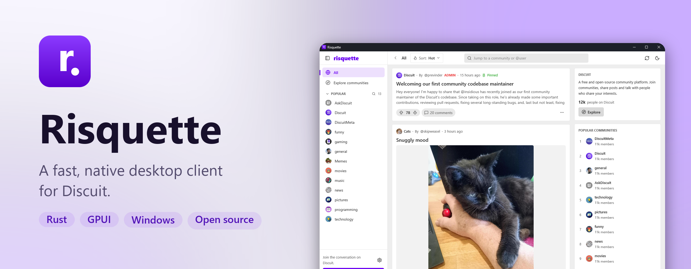
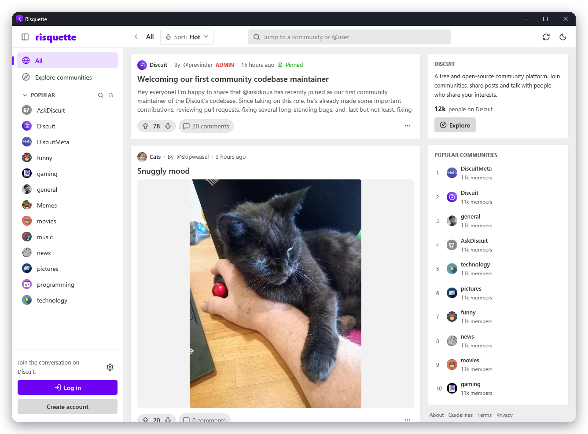

<picture>
  <source media="(prefers-color-scheme: dark)" srcset="branding/banner-dark.png">
  
</picture>

<p align="center">
  <a href="https://github.com/tyler-Github/risquette/releases/latest"></a>
  <a href="https://risquette.xnoid.studio"></a>
</p>

<p align="center">
  <a href="https://github.com/tyler-Github/risquette/releases"></a>
  
  
</p>

<p align="center">
  Browse your <a href="https://discuit.org">Discuit</a> communities, post, comment and get notified,<br>
  in a real desktop app instead of a browser tab.
</p>

<br>

## Highlights

|  |  |
| --- | --- |
| **Native and fast**<br>Written in Rust on [GPUI](https://gpui.rs), the UI framework behind the Zed editor. | **Everything Discuit does**<br>Feeds, posts, threaded comments, notifications, saved lists, mod tools and admin. |
| **Any instance**<br>Use discuit.org or any other Discuit server, with a separate login for each. | **Media done right**<br>Image carousels, plus pop-out players for YouTube, Vimeo and other videos. |
| **Light and dark**<br>Themes based on Discuit's own design, following your system. | **Updates itself**<br>A branded installer and updater, with every download checksum-verified. |

<p align="center">
  <picture>
    <source media="(prefers-color-scheme: dark)" srcset="branding/framed/app-dark.png">
    
  </picture>
</p>

## Install

Download **RisquetteSetup** from the [latest release](https://github.com/tyler-Github/risquette/releases/latest) and run it. It installs just for you, with no administrator rights, and keeps itself up to date.

Risquette currently targets Windows 10 and 11.

## Build from source

```sh
git clone https://github.com/tyler-Github/risquette
cd risquette
cargo run --release
```

## Documentation

- [Features](docs/features.md): everything Risquette can do, plus keyboard shortcuts
- [Development](docs/development.md): project layout, running, testing
- [Releasing and updates](docs/releasing.md): packaging, the installer and the update server

## Acknowledgements

Risquette is an independent client for [Discuit](https://github.com/discuitnet/discuit) and isn't affiliated with the Discuit project. It's built with [GPUI](https://gpui.rs) and uses [Lucide](https://lucide.dev) icons (ISC).

## License

[Apache-2.0](LICENSE)
