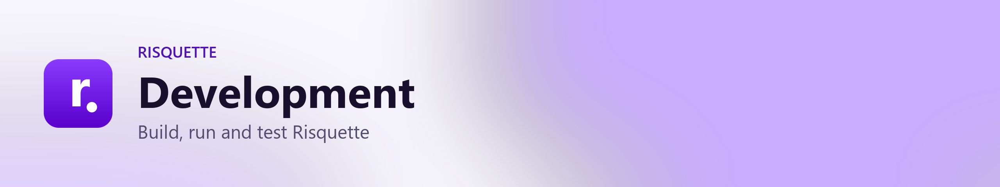
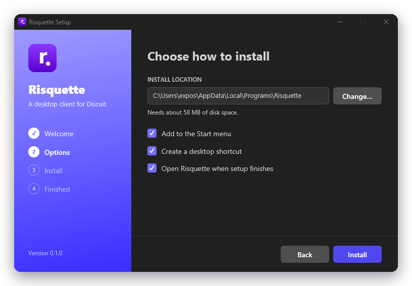
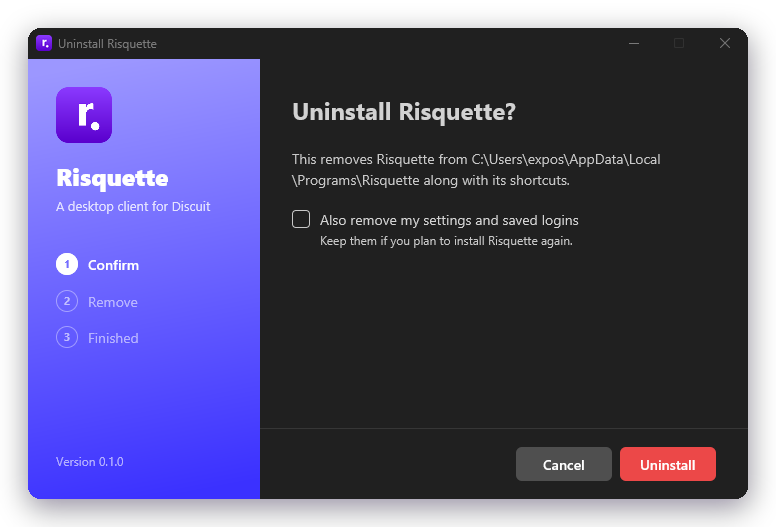

<picture>
  <source media="(prefers-color-scheme: dark)" srcset="../branding/headers/development-dark.png">
  
</picture>

## Project layout

| Path | What's there |
| --- | --- |
| `crates/discuit-api` | A blocking client for all 95 Discuit API endpoints: cookie session, CSRF header, multipart uploads and the error envelope. It also has the comment-tree helpers. |
| `crates/risquette-theme` | Discuit's design tokens (from its `_base.scss`) as GPUI colours and sizes. |
| `crates/risquette` | The desktop app. |
| `crates/risquette-installer` | The installer, updater and uninstaller (`risquette-setup.exe`). |
| `branding/` | Logo, banners, social preview and screenshots. |
| `scripts/` | Packaging (`package.ps1`), release notes (`changelog.py`), image generation (`make_icon.py`, `make_branding.py`) and the docs link check (`check_docs.py`). |
| `CHANGELOG.md` | User-facing changes per release; the source of release notes. |
| `docs/` | These documents. |
| `.github/` | CI and release workflows, issue and pull request templates, CODEOWNERS and Dependabot. |

The update server is a separate project, **Risquette-Backend**: a small axum service that answers update checks from this repository's GitHub releases and serves the website at `https://risquette.xnoid.studio`. See [releasing.md](releasing.md).

For how to propose changes and how pull requests get reviewed, see [CONTRIBUTING.md](../CONTRIBUTING.md).

## Running

You need a stable Rust toolchain. On Windows you also need the MSVC build tools and the Windows SDK.

```sh
cargo run                                  # start the app
cargo run -- https://discuit.org/@alice    # open a Discuit link on startup
cargo run -p risquette-installer           # the installer (see below)
```

| Variable | Effect |
| --- | --- |
| `RISQUETTE_BASE_URL` | The instance to connect to. Overrides the one chosen in Settings (default `https://discuit.org`). |
| `RISQUETTE_CONFIG_DIR` | Use a separate settings folder, for a clean test profile or a portable setup. Only one copy of Risquette runs per settings folder, so a test profile can run alongside your normal one. |
| `RISQUETTE_WINDOWED` | Open at 1280×900 instead of maximized (used for the branding screenshots, so they stay the same size). |
| `RISQUETTE_TEST_NOTIFICATION` | Show the tray icon and a sample desktop notification three seconds after start, without needing an account. |
| `RISQUETTE_UPDATE_URL` | *Build time.* A different default update server to bake into the app (default `https://risquette.xnoid.studio`). |
| `RUST_LOG` | Logging. For example, `risquette=debug,discuit_api=debug` logs every request (image signatures are redacted). |

Settings and saved logins live in `state.json` in `%APPDATA%\Risquette` (Windows), `~/.config/risquette` (Linux) or `~/Library/Application Support/Risquette` (macOS).

### Logs and crash reports

`crates/risquette/src/crash.rs` handles both. Everything logged also goes to `%LOCALAPPDATA%\Risquette\logs
isquette.log`, which is rotated at 2 MB with one old copy kept. If the app panics on any thread:

1. A report goes to `%LOCALAPPDATA%\Risquette\crashes\crash-<time>.txt`, and only the newest 10 are kept. It contains the version, the Windows version, the panic message and its location, the last 100 log lines and a backtrace.
2. The app starts a second copy of itself as `risquette --crash-report <file>` and exits, because a crashed app can't safely draw UI. That copy shows the crash window, which can open a pre-filled GitHub issue, restart the app, copy the details or show the file.

With `RISQUETTE_CONFIG_DIR` set, logs and crash reports go there too. To try the flow, set `RISQUETTE_TEST_CRASH=1` and the app panics on purpose three seconds after starting. Release builds strip debug symbols, so backtraces show addresses only; the panic message and file location are always exact.

<p align="center">
  
  <br>
  <sub>The installer (<code>crates/risquette-installer</code>) is a GPUI app too</sub>
</p>

A development build of the installer contains no app. Instead it installs a `risquette.exe` it finds next to itself. In debug builds, `--preview options|working|done|failed` shows a page without doing anything, which is useful for screenshots.

## Testing

```sh
cargo test --workspace
```

Unit tests never contact a real instance. Write endpoints are checked against a local one-shot HTTP server that records the method, path, headers (including `X-Csrf-Token`) and body. An optional read-only (GET-only) smoke test against the live site runs on request:

```sh
cargo test -p discuit-api --test live_read -- --ignored
```

### CI

Every pull request and push to `main` runs `.github/workflows/ci.yml`. All of these checks must pass before a pull request can merge:

| Check | Runs |
| --- | --- |
| Formatting | `cargo fmt --all --check` (style in `rustfmt.toml`) |
| Clippy | `cargo clippy --workspace --all-targets --locked -- -D warnings` |
| Tests | `cargo test --workspace --locked`, then a full build |
| Docs and links | `python scripts/check_docs.py` (every local link and image in the Markdown exists), plus `python scripts/changelog.py check` and the changelog script's tests |
| Dependency audit | `cargo audit` against the RustSec advisory database |

A separate **Changelog entry** check (`.github/workflows/changelog.yml`) asks for a `CHANGELOG.md` line when a pull request changes the app. See [Release notes](releasing.md#release-notes).

Dependabot opens weekly pull requests for Cargo and GitHub Actions updates. GPUI, wry and windows are left alone because their versions must match. Third-party actions are pinned to exact commits.

### Manual checklist

These features change data on the server, so they're tested by hand.

- [ ] Log in, restart the app and confirm you're still logged in; then log out.
- [ ] Sign up. If the instance requires hCaptcha, this fails with a message explaining how to sign up on the website instead.
- [ ] Vote on a post and a comment: up, the same direction again to remove the vote, then the other direction.
- [ ] Comment on a post and reply to a comment, then edit and delete each.
- [ ] Create a text post, a link post (try "Fetch title") and an image post with two images and captions.
- [ ] Edit and delete your own post.
- [ ] Join and leave a community; the sidebar updates.
- [ ] Save a post to a new list, open the list, then remove the item.
- [ ] Hide a post; report a post or comment; mute and unmute a user and a community.
- [ ] Notifications: open the page (the badge clears), mark read and unread, delete.
- [ ] Settings: change the about text and preferences, upload and remove a profile picture, change the password.
- [ ] As a mod: lock, pin and remove posts; edit rules; add a moderator; ban and unban; handle reports.
- [ ] As an admin: site settings, community requests, IP blocks.
- [ ] Settings → Instance: connect to another instance, log in there, then switch back. Each instance keeps its own login.
- [ ] Updates: with a test release, download, install and restart from the update dialog; skip a version; switch to beta.
- [ ] Installer: install, check the shortcuts and the Apps & features entry, reinstall over it, then uninstall (with and without removing data).

## Branding

`branding/` holds the generated images. To regenerate them after changing the icon or the screenshots:

```sh
python scripts/make_branding.py   # needs Pillow
```

The script also refreshes `assets/risquette.ico`, which gets built into both executables. `branding/framed/` holds the same screenshots with rounded corners and a shadow, which the docs use. To screenshot the crash window without crashing, run `risquette --crash-report <file>` with a saved report. The screenshots in `branding/screenshots/` are window captures of the app, logged out, using a clean `RISQUETTE_CONFIG_DIR` and `RISQUETTE_WINDOWED=1`.

## Notes

- GPUI runs its own smol-based executor, so `discuit-api` is synchronous (ureq) and is called from background tasks.
- The live API returns `averageColor` as a CSS string (`"rgb(r,g,b)"`) rather than the documented `{r,g,b}` object. The models accept both.
- `crates/risquette/src/input.rs` is adapted from GPUI's `examples/input.rs` (Apache-2.0).
