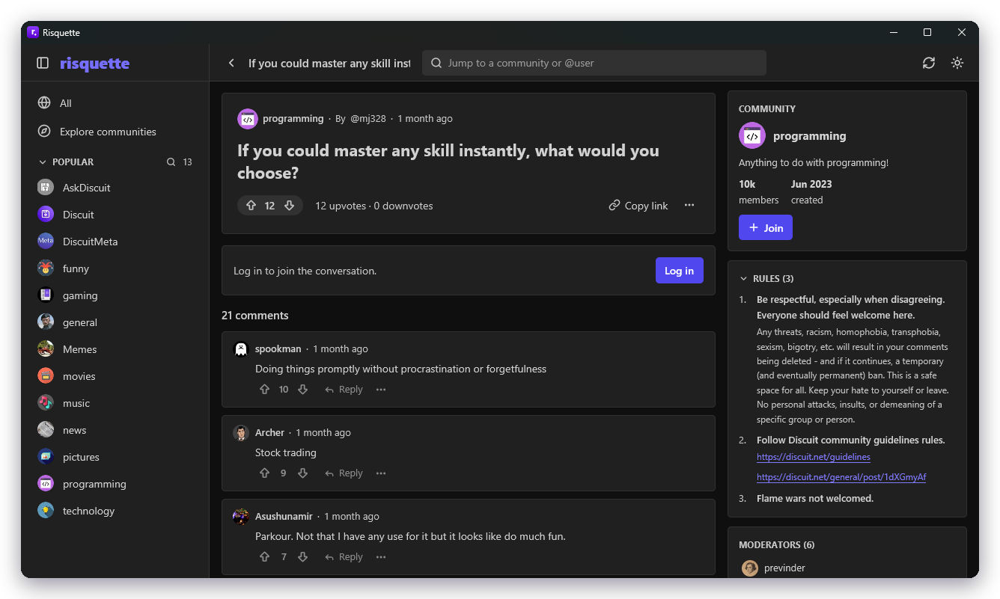
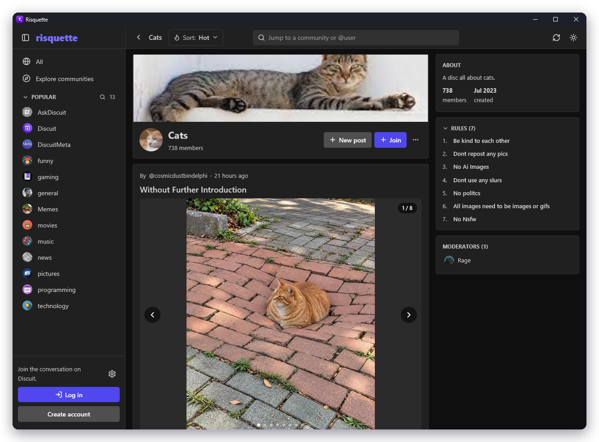
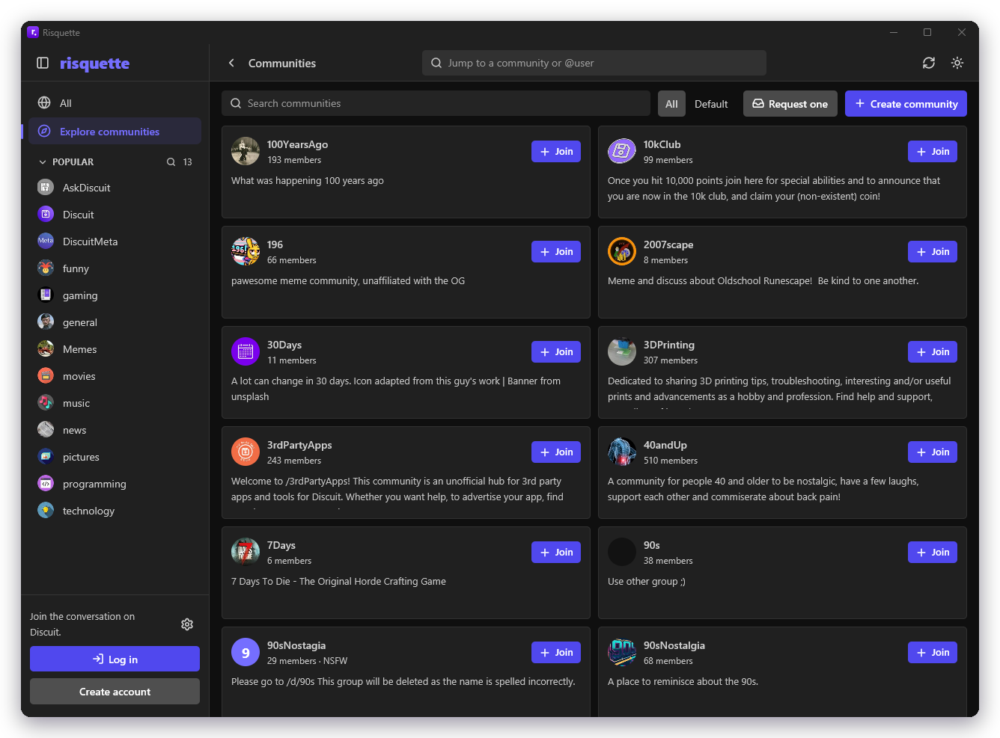
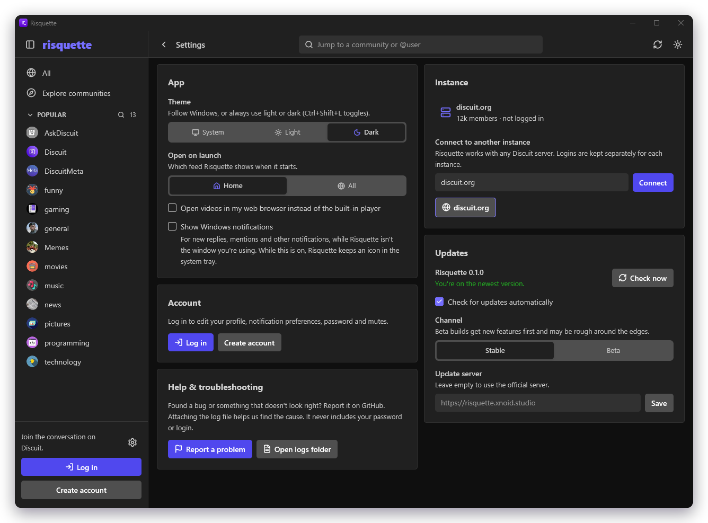
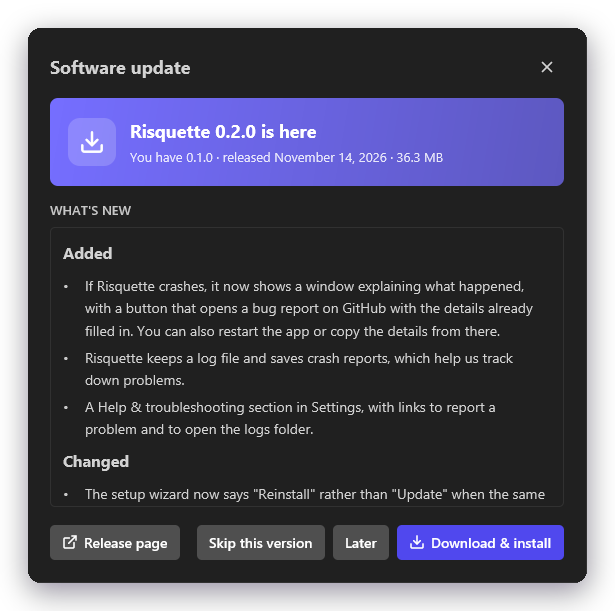
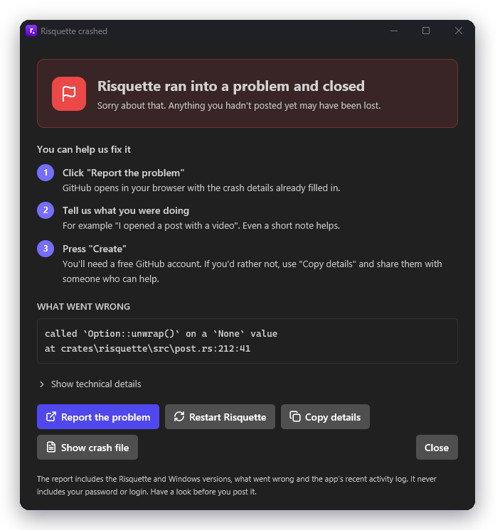

<picture>
  <source media="(prefers-color-scheme: dark)" srcset="../branding/headers/features-dark.png">
  
</picture>

Everything Risquette can do today. For a quick overview, see the [README](../README.md).

## Reading

- **Feeds:** Home (your joined communities) and All, sorted by Hot, New, Activity or Top, with infinite scroll. While you read, Risquette checks the feed on screen once a minute and offers new posts with a "3 new posts" button at the top, instead of moving the feed under you.
- **Posts:** text, image and link posts. Image posts with several pictures open as a carousel with captions. YouTube, Vimeo, Streamable, Dailymotion and direct video links play in a pop-out player, or in your browser if you prefer.
- **Formatting:** posts and comments render markdown as the Discuit website does, including tables, task lists, footnotes and code blocks. `@username` mentions and bare web addresses become links.
- **Comments:** threaded and collapsible, with thread guides, inline replies and "show more replies".
- **Communities:** banner, about, rules and moderators. Browse and search all communities.
- **Profiles:** about text, badges, stats, moderated communities, and the user's posts and comments.
- **Saved lists:** your own lists and other people's public lists.
- **Links:** Discuit links open inside the app, and `risquette <link>` opens one from the command line.

<table>
  <tr>
    <td width="50%"></td>
    <td width="50%"></td>
  </tr>
  <tr>
    <td align="center">Threaded comments with voting and replies</td>
    <td align="center">Community pages with rules and moderators</td>
  </tr>
</table>

## Taking part

- **Accounts:** log in, sign up and log out. Your session is remembered between launches.
- **Multiple accounts:** stay logged in to several accounts and switch between them from the account menu or Settings → Accounts. Logging out of one switches to the next.
- **Voting, commenting and posting:** with a markdown toolbar and preview, drag-and-drop image uploads, community suggestions, and a "fetch title" button for links.
- **Drafts:** unsent comments, replies and posts are kept as you type, so leaving the page, closing Risquette or a failed send doesn't lose them. They come back when you return, with a note and a **Discard** link, and are removed once sent. Images in a new post aren't kept, and drafts are forgotten after 30 days.
- **Post and comment menus:** save to a list, copy the link, hide, report, mute, edit and delete.
- **Notifications:** a bell in the toolbar with an unread counter. You can mark notifications read or unread and delete them, one at a time or all at once.
- **Desktop notifications:** new notifications also appear as desktop notifications while Risquette isn't the window you're using. Clicking one opens it in the app. They're off by default; turn them on in Settings → App. On Windows, a tray icon is shown while they're on: click it to bring the window back, or right-click to quit.
- **Communities:** join, leave or mute them, and create or request new ones.

   
  Browse, search and join communities

## Moderating

- **Mod tools (per community):** settings, icon and banner, rules, moderators, bans, the report queue, and removed or locked posts. Posts and comments can also be locked, pinned or removed from their menus.
- **Admin:** site settings, site-wide bans and badges, default communities, community requests, IP blocks, the user and comment listings, and analytics.

## The app

- **Any Discuit instance:** switch servers in Settings → Instance. Risquette checks the address before switching and keeps a separate login for each instance.
- **Settings:** profile picture, about text, preferences, password, muted users and communities, and account deletion. App settings work while logged out too: theme (System, Light or Dark), the feed to open on launch, and how videos open.
- **Updates:** Risquette checks for new versions in the background, then shows a pill in the toolbar and an update dialog with release notes. Updates download with a progress bar and are checked against their SHA-256 before the app restarts into the new version. There are stable and beta channels, and you can skip a version.
- **One window:** Risquette opens maximized, and opening it while it's already running brings the existing window to the front.
- **Losing the connection:** if the server can't be reached for more than a moment, Risquette shows a reconnecting screen and keeps trying, counting down to each attempt (**Try now** skips the wait). **Use a different server** sets the screen aside for a slim banner and opens Settings. Once the server is back, pages that failed to load reload themselves, along with any missing images and your account. Only loading is retried: nothing you send is repeated.
- **Crash reports:** if something goes wrong, Risquette saves a report and shows a friendly window explaining what happened. It can open a GitHub issue with the details already filled in, or restart the app. Settings → Help & troubleshooting opens the log and crash-report folders.
- **Windows and Linux:** on Windows, a branded, per-user setup wizard that needs no administrator rights. It creates Start menu and desktop shortcuts, adds an entry in Apps & features, and installs a matching uninstaller. On Linux, a single AppImage that runs on most distributions and replaces itself when it updates.
- **Interface:** a collapsible sidebar that shrinks to an icon rail, light and dark themes based on Discuit's own design, and [Lucide](https://lucide.dev) icons.

<table>
  <tr>
    <td width="58%"></td>
    <td width="42%"></td>
  </tr>
  <tr>
    <td align="center">App settings, including the instance and updates</td>
    <td align="center">Updates come with release notes</td>
  </tr>
</table>

   
  If something goes wrong, Risquette explains what happened and helps report it

## Keyboard

| Keys | Action |
| --- | --- |
| `Esc` / `Alt+Left` | Back, or close a dialog |
| `F5` / `Ctrl+R` | Refresh |
| `Ctrl+Shift+L` | Toggle light and dark theme |
| `Ctrl+Enter` | Send a comment |
| `Ctrl+Q` | Quit |
