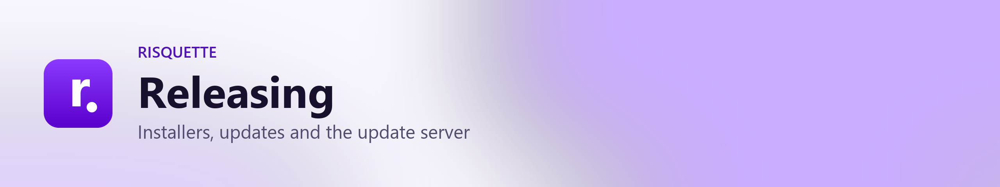
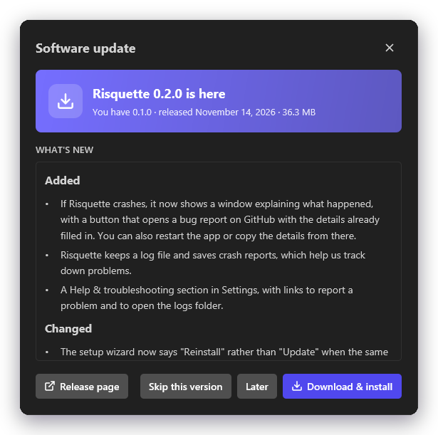
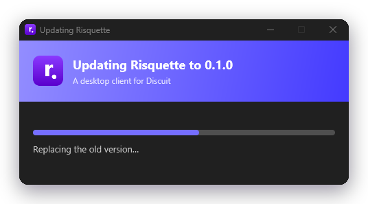
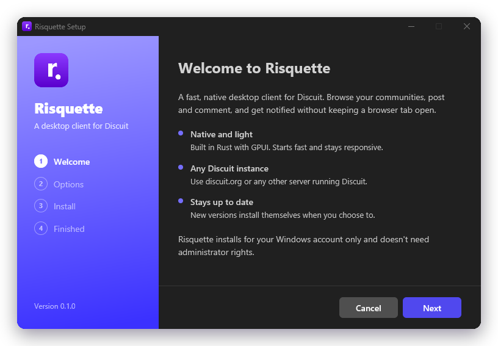

<picture>
  <source media="(prefers-color-scheme: dark)" srcset="../branding/headers/releasing-dark.png">
  
</picture>

Risquette ships as a Windows installer and a Linux AppImage attached to GitHub releases. The update server reads those releases and tells the app when a newer version exists.

```
GitHub release ──► Risquette-Backend ──► app: "0.2.0 is available"
 (installer + .sha256)   (/v1/updates)       download → verify → installer --update
```

<table>
  <tr>
    <td width="54%"></td>
    <td width="46%" valign="middle"></td>
  </tr>
  <tr>
    <td align="center"><sub>1. The app offers the update with its release notes</sub></td>
    <td align="center"><sub>2. The installer swaps in the new version and reopens the app</sub></td>
  </tr>
</table>

## Cutting a release

Only the repository owner can publish releases. The "Protect release tags" ruleset stops anyone else creating, moving or deleting `v*` tags, the release job refuses to run for anyone but the owner, and it runs in the `release` environment, which only accepts `v*` tags.

1. **Prepare the release** on a branch:
   ```sh
   python scripts/changelog.py prepare 0.2.0
   ```
   This turns the "Unreleased" notes in `CHANGELOG.md` into a dated `0.2.0` section, bumps the version in `Cargo.toml` and refreshes `Cargo.lock`. Read the notes through: they're what users see.
2. **Commit and merge** the changes, e.g. "Release v0.2.0".
3. **Tag and push** from the updated `main`:
   ```sh
   git tag v0.2.0 && git push origin v0.2.0
   ```
   A tag with a suffix, such as `v0.3.0-beta.1`, becomes a pre-release and is offered only on the beta channel. That makes a beta the safe way to try a release: switch one install to the beta channel in Settings → Updates and check that it updates before you publish the stable version.
4. `.github/workflows/release.yml` checks that the tag matches the version and that `CHANGELOG.md` has notes for it. Then it builds and tests on Windows and Linux side by side, and publishes the release once with four files:
   - `RisquetteSetup-<version>-windows-x86_64.exe` and its `.sha256`
   - `Risquette-<version>-linux-x86_64.AppImage` and its `.sha256`

   The app won't install an update without the checksum file. The AppImage is built on Ubuntu 22.04, so it runs on distributions at least that new.

### Bug-fix releases

A release that only fixes things gets a bug-fix version: the last number goes up, like `0.3.1` after `0.3.0`. It's quicker to release and the website marks it as a bug fix.

1. Make sure the Unreleased notes only have **Fixed** (or **Security**) entries. `python scripts/changelog.py prepare 0.3.1` refuses a bug-fix version if they have **Added** entries: new features go in a feature release, like `0.4.0`.
2. Commit, merge, then tag and push `v0.3.1` as usual.

The release workflow treats every release the same way, except:

- Before building, it waits for CI to pass on the tagged commit, and stops if a required check failed. So tag a commit that's on `main`.
- A bug-fix release doesn't run the tests again, because CI just ran them on that exact commit. That takes the release from roughly 27 minutes to roughly 12. Feature releases and betas still run them as a last check.
- Release binaries are always built from scratch, without a build cache.

`python scripts/changelog.py kind <version>` prints which kind a version is: `feature` (ends in `.0`), `bugfix`, or `beta` (has a suffix).

### Betas

A beta goes to people on the beta channel first, so you can check a release, including the update itself, before everyone gets it:

1. `python scripts/changelog.py prepare 0.2.0-beta.1`, commit, merge, then tag and push `v0.2.0-beta.1`. It's published as a pre-release.
2. On an install switched to the beta channel (Settings → Updates), check that it updates and works.
3. If something needs fixing, merge the fixes with changelog entries as usual, and release `0.2.0-beta.2` the same way. It takes the notes added since beta 1.
4. When it's ready, `python scripts/changelog.py prepare 0.2.0` promotes it. Even with nothing new under Unreleased, this gathers the notes of every `0.2.0-beta.N` into one `0.2.0` section, merged by heading with duplicates dropped, and removes the beta sections. Stable users then see everything since the last stable release, and the "Full changelog" link compares against it. The betas' GitHub pre-release pages keep their own notes.

### Release notes

`CHANGELOG.md` is the source of release notes. It follows [Keep a Changelog](https://keepachangelog.com/en/1.1.0/): changes collect under `## [Unreleased]`, grouped as Added, Changed, Deprecated, Removed, Fixed or Security, and `prepare` turns them into a release. The release workflow publishes that version's section as the release text, plus a "Full changelog" link to the code changes, and the app's update dialog shows it under "What's new". So:

- Write entries for people using the app ("Text boxes no longer shrink…"), not for developers ("Wrap inputs in flex columns").
- Pull requests that change the app need an entry. The **Changelog entry** check fails without one, unless the pull request has the `no-changelog` label for changes users won't notice. Dependabot pull requests are skipped.
- GitHub's automatic release notes are turned off: they list pull request titles with @mentions, which the app would show as links to Discuit profiles.

`python scripts/changelog.py check` validates the file (CI runs it), and `python scripts/changelog.py notes 0.2.0` prints a version's notes.

### Settings

| Kind | Name | Purpose |
| --- | --- | --- |
| Repository variable (optional) | `RISQUETTE_UPDATE_URL` | A different update server to bake into the app. Without it, builds use the official server, `https://risquette.xnoid.studio`. |
| `release` environment secret (optional) | `SIGNTOOL_CERT_BASE64` | A code-signing `.pfx`, base64-encoded. |
| `release` environment secret (optional) | `SIGNTOOL_PASSWORD` | Its password. |

Put the signing secrets in the `release` environment (Settings → Environments → release) rather than at repository level, so only release runs can read them.

## Building an installer locally

```powershell
./scripts/package.ps1
```

Add `-UpdateUrl https://updates.example.com` to build against a self-hosted update server.

This writes the installer and its checksum to `dist/`. On Linux, `./scripts/package-linux.sh` builds the AppImage the same way (set `RISQUETTE_UPDATE_URL` for a self-hosted server). It downloads a pinned, checksum-verified `linuxdeploy` to bundle the libraries the app needs.

## Installer command line

<p align="center">
  
</p>

| Command | Effect |
| --- | --- |
| `risquette-setup.exe` | The install wizard. |
| `risquette-setup.exe --silent [--dir PATH]` | An unattended install. |
| `risquette-setup.exe --update --wait-pid N --launch` | Used by the app's updater: waits for the app to exit, replaces it, then reopens it. |
| `uninstall.exe [--silent]` | Uninstall. Opening `uninstall.exe` in the install folder shows the uninstaller; Apps & features runs `uninstall.exe --uninstall`. |

Installs are per-user and need no administrator rights:

- Files go to `%LOCALAPPDATA%\Programs\Risquette`.
- The uninstall entry goes under `HKCU\Software\Microsoft\Windows\CurrentVersion\Uninstall\Risquette`.
- Uninstalling removes the app, its shortcuts and the uninstall entry. If the user ticks "Also remove my settings and saved logins", it also deletes `%APPDATA%\Risquette` (settings and logins) and `%LOCALAPPDATA%\Risquette` (logs and crash reports).

## The update server

The official server runs at `https://risquette.xnoid.studio` on Fly.io, behind Cloudflare. It also serves the project website at `/`. Its code is in the separate **Risquette-Backend** project, whose README covers deploying to Fly. To run your own, deploy it anywhere that runs a container or a Rust binary, and point it at this repository:

| Variable | Purpose |
| --- | --- |
| `GITHUB_REPO` | `owner/name` of this repository (default `tyler-Github/risquette`). |
| `GITHUB_TOKEN` | Optional. Raises GitHub's rate limit. |
| `CACHE_SECONDS` | How long to cache release data (default 300). |
| `BIND` | Listen address (default `0.0.0.0:8787`). |

The app calls `GET /v1/updates/<platform>?channel=stable&current=<version>`, where the platform is `windows-x86_64` or `linux-x86_64`. Users can point the app at a different server in Settings → Updates.
